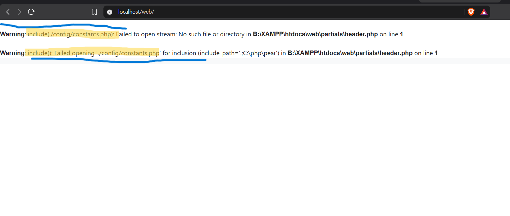

# sourcecodester Online Food Ordering System in PHP and MySQL Source Code — Arbitrary File Deletion via Path Traversal

## Vendor

sourcecodester

## Product

Online Food Ordering System in PHP and MySQL Source Code  
Product URL: https://www.sourcecodester.com/php/18232/food-order-system.html

## Vulnerability

Path traversal in `admin/delete.php` can allow arbitrary file deletion (CWE-22 / CWE-73).

**Discovered by:** Shailendra Mourya (CyberShailendra)  
**Affected files:** `admin/delete.php`; similar patterns are reported in `admin/delete_category.php`, `admin/update_food.php`, and `admin/update_category.php`  
**Report date:** 2026-10-10  
**Status:** Reported as reproduced on a local XAMPP test instance.

---

## Finding Details

| Field | Value |
|---|---|
| **Title** | Online Food Ordering System `delete.php` Path Traversal Arbitrary File Deletion |
| **Affected File** | `admin/delete.php` (same pattern present in `admin/delete_category.php`, `admin/update_food.php`, `admin/update_category.php`) |
| **Vulnerability Type** | Path Traversal (CWE-22) → Arbitrary File Deletion (CWE-73) |
| **Attack Vector** | Network (remote) |
| **Authentication Required** | None (see VDB-NC-003 — delete scripts have no login check) |
| **CVSS 3.1 Vector (estimated)** | AV:N/AC:L/PR:N/UI:N/S:U/C:N/I:N/A:H |
| **CVSS 3.1 Score (estimated)** | 7.5 (High) |
| **Root Cause** | `$_GET['image_name']` is concatenated directly into a filesystem path and passed to `unlink()` with no sanitization: `unlink('../images/food/'.$image);` |
| **Proof of Concept** | `GET /web/admin/delete.php?id=1&image_name=../../config/constants.php` |
| **Observed Impact** | `config/constants.php` was deleted on the test instance, taking down the entire application (every page that includes `header.php` failed with `Warning: include(./config/constants.php): Failed to open stream`). |
| **Confirmed By** | User, local XAMPP instance, 2026-10-10 — file deletion verified via PHP fatal include warnings. |
| **Remediation** | Use `basename()` to strip path components from the filename, then verify via `realpath()` that the resolved path is still inside the intended upload directory before calling `unlink()`. |

---
## Evidence Screenshots

Replace these placeholders with the corresponding screenshots:



## Technical Details — Vulnerable Code (`admin/delete.php`)

```php
<?php 
include('../config/constants.php');
if(isset($_GET['id']) && isset($_GET['image_name'])){
    $id = intval($_GET['id']);
    $image = $_GET['image_name'];              // <-- raw, attacker-controlled

    if(!empty($image) && file_exists('../images/food/'.$image)){
        unlink('../images/food/'.$image);       // <-- traversal reaches any file
    }

    $sql = "delete from tbl_food where id=$id";
    $res = mysqli_query($conn, $sql);
    if($res == true){
        $_SESSION['delete_food'] = "food deleted successfully";
        header('Location:'.SITEURL.'admin/food.php');
    }
}else{
    header('Location:'.SITEURL.'admin/food.php');
}
?>
```

The application does not validate `$image` before using it. A path such as `../../config/constants.php` can resolve outside `images/food/`, allowing `unlink()` to target an application file.

---

## Remediation Code

```php
<?php 
include('../config/constants.php');
include('user_logged.php');   // also closes VDB-NC-003 for this endpoint

if(isset($_GET['id']) && isset($_GET['image_name'])){
    $id = intval($_GET['id']);
    $image = basename($_GET['image_name']);     // strips ../ and /

    $upload_dir = realpath('../images/food');
    $target = realpath($upload_dir . '/' . $image);

    // only unlink if resolved path is still inside the upload directory
    if(!empty($image) && $target !== false && strpos($target, $upload_dir) === 0 && is_file($target)){
        unlink($target);
    }

    $sql = "delete from tbl_food where id=?";
    $stmt = mysqli_prepare($conn, $sql);
    mysqli_stmt_bind_param($stmt, "i", $id);
    $res = mysqli_stmt_execute($stmt);

    if($res){
        $_SESSION['delete_food'] = "food deleted successfully";
        header('Location:'.SITEURL.'admin/food.php');
        exit();
    }
}else{
    header('Location:'.SITEURL.'admin/food.php');
    exit();
}
?>
```
